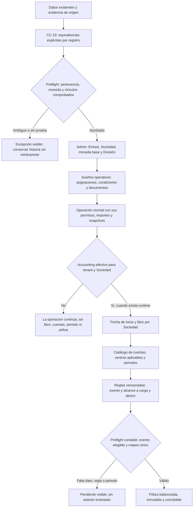

# CC-19: mapeos de datos y configuración contable opcional

**Corte:** CHG-326, 2026-10-14. **Estado:** guía para preparar datos; CC-19 no tiene backfill aprobado ni ejecutado. Accounting sigue `planned` y apagado. Los ejemplos de cuentas son funciones contables por definir, no números de cuenta ni pólizas implementadas.

## Vista completa



La rama `No` es un modo de operación legítimo. Activar Accounting en el futuro no contabiliza automáticamente documentos anteriores. Costing conserva el catálogo básico de centros por División; Accounting conserva libros, cuentas, reglas, periodos y pólizas. Un centro se exige sólo al flujo de imputación que lo requiera. Ver [política de módulo opcional](contabilidad_opcional_y_capacidades.md) y [control por submódulo](../contexto/CONTROL_CONTABLE.md).

## 1. Información que se necesita para CC-19

Entregar un padrón autorizado por **tenant**, con ID/código de cada Emisor, Sociedad y División, relación Emisor → Sociedad → División, moneda base y vigencia. Los IDs históricos deben conservarse mediante equivalencias; una sola Sociedad o División disponible no demuestra que todos los registros le pertenecen. Para cada correspondencia hace falta fuente, fecha, responsable que la confirma y tratamiento de los casos ambiguos. No incluir secretos ni datos personales innecesarios en este repositorio.

| Dueño | Correspondencia que debe proporcionar el negocio | Dato que no se debe inferir |
|---|---|---|
| Admin | ID legado → Emisor, Sociedad y División; vigencias; pertenencia y alcance de usuarios. | Sociedad/División por ser el único valor del tenant. |
| Inventory | Almacén físico → División; artículo compartido → Divisiones elegibles; movimientos, reservas, transferencias, recepciones y sobrantes → origen y contexto demostrables. | División histórica desde la asignación actual del almacén; moneda desde `unit_cost` legado. |
| Production | Máquina física → División; producto/servicio → Divisiones; receta/orden/solicitud comercial → origen, recursos, almacén y contexto. | Moneda de `standard_cost`, costo confirmado, trabajador o capacidad histórica. |
| RH | Puesto y trabajador → asignaciones por División, puesto vigente y elegibilidad; tarifa confirmada con Sociedad, moneda y fecha. | Moneda de una tarifa antigua, salario o capacidad duplicada por multiadscripción. |
| Sales | Cliente → Divisiones y condiciones de cada alcance; cotización → pedido → entrega/servicio; División, moneda, tasa y evidencia de cada documento y partida. | Condiciones actuales como si fueran las históricas; costo estimado legado sin snapshot CC-21. |
| Purchasing | Proveedor → Divisiones y condiciones; requisición → orden → recepción; almacén/movimiento de Inventory para bienes; moneda, tasa y evidencia por documento. | Condiciones actuales, recepción de servicio como movimiento físico o recosteo sin prueba. |
| Maintenance | Máquina u origen → División de la orden; técnico, tiempo y refacciones → orden, puesto/tarifa y almacén de origen. | Técnico, tarifa, costo o contexto de refacciones a partir de configuración posterior. |
| Costing | Centro de costos → División y vigencia; equivalencia de centros legados cuando el flujo los usa. | Centro predeterminado fabricado para llenar huecos. |

**Formato mínimo de cada fila de mapeo:** `tenant_id`, `source_system`, `source_table`, `source_id`, `source_date`, `target_division_id` cuando corresponda, `target_society_id` derivada y verificada, `evidence_reference`, `mapping_status` (`approved`/`exception`), `approved_by`, `approved_at` y huella de origen. Para valores monetarios agregar moneda original, importe, tasa y fecha de la tasa, moneda base y evidencia; un importe sin moneda confirmada queda sin convertir. Para documentos encadenados agregar IDs del padre y de sus partidas, sin sustituirlos por códigos o nombres coincidentes.

**Regla de historia:** distinguir asignación de un maestro para operar desde ahora de clasificación de un documento pasado. Una asignación nueva no rellena el contexto histórico. Códigos/folios, condiciones, plantillas, costos y márgenes anteriores se conservan; snapshots ausentes no se reconstruyen desde catálogos actuales. Una cotización histórica cuya moneda contradice las condiciones de la División necesita resolución individual; no basta fijarle División.

### Preflight y ejecución futura

1. Inventariar conteos por tenant/tabla y faltantes de contexto, moneda, tasa, vínculos y snapshots; identificar duplicados, huérfanos, cruces de Sociedad y datos contradictorios.
2. Preparar equivalencias por ID con evidencia y lista explícita de excepciones. Revisar con cada dueño y aprobar una huella del archivo fuente y del plan.
3. Simular resultados y comparar cantidades e importes de origen y destino. Si cambia la fuente o el destino, invalidar la aprobación.
4. Ejecutar backfill por dueño y en lotes idempotentes, sólo en el ambiente y tenant autorizados, con auditoría, reintentos y rollback definidos. Ningún servicio escribe tablas de otro.
5. Reconciliar por ID original, documento y partida: procesados, pendientes, excepciones y diferencias. Restringir compatibilidad antigua sólo después de revisar historia y consumidores.

## 2. Configuración adicional para contabilizar cuando exista Accounting

Esto es **configuración futura del módulo Accounting**, separada de CC-19. Preparar los datos operativos no activa asientos. Por cada Sociedad que elija contabilizar se necesitará:

| Orden | Configuración | Decisión que debe aportar la empresa |
|---|---|---|
| 1 | Activación | Tenant/Sociedades incluidas, fecha de inicio, alcance histórico si lo hubiera, responsables y permisos. Runtime y entitlement deben existir y estar efectivos. |
| 2 | Libro | Un libro por Sociedad, ligado a su moneda base; política de ejercicios, periodos y cierres. |
| 3 | Catálogo de cuentas | Código, nombre, naturaleza, tipo/jerarquía, vigencia, estado y si exige Centro de costos. Los números concretos pertenecen a la empresa y su asesor contable. |
| 4 | Centros y dimensiones | Centros válidos por División para los flujos que los requieran; reglas de imputación y excepción. Emisor se deriva de Sociedad. |
| 5 | Políticas de reconocimiento | Qué hecho confirmado produce cada evento y en qué fecha: recepción, consumo, terminado, entrega, factura, cobro o pago. Un pedido o cotización por sí solo es compromiso. |
| 6 | Reglas de cuentas | Tipo de evento + Sociedad/libro + alcance + vigencia + filtros → roles de cargo/abono. Prioridad y versión; cero coincidencias o empate dejan pendiente. |
| 7 | Moneda e impuestos | Moneda original/base, tasa capturada, precisión y redondeo; cuentas y clasificación fiscal sólo cuando existan documentos y reglas verificadas. |
| 8 | Apertura y pruebas | Saldos iniciales y posible historia a importar con conciliación y autorización separadas; simulación de reglas, permisos, periodo cerrado, duplicados, reversas y balance. |

### Roles de cuenta a decidir, sin fijar números

| Hecho futuro | Roles de cuentas que probablemente se deban mapear | Decisión pendiente |
|---|---|---|
| Recepción de material | Inventario ↔ recepción no facturada. | Criterio de valuación, variación y diferencia con factura. |
| Consumo de material en Production | Producción en proceso ↔ inventario de material. | Tratamiento de merma, sobrante y variaciones. |
| Terminado recibido | Inventario de producto terminado ↔ producción en proceso. | Acumulación de material, mano de obra y máquina. |
| Entrega con costo | Costo de venta ↔ inventario terminado. | Momento del costo y reversa/devolución. |
| Recepción de servicio o gasto | Gasto, activo o producción en proceso ↔ recepción no facturada. | Clasificación por tipo/División/Centro, nunca por defecto universal. |
| Tiempo y refacciones de Maintenance | Gasto de mantenimiento, producción en proceso o activo ↔ origen de costo. | Política expresa para gasto, capitalización y devolución. |
| Factura de venta y cobranza | Clientes ↔ ingreso e impuestos; bancos/clearing ↔ clientes. | Facturación, impuestos, cartera y medios de pago cuando existan esos módulos. |
| Factura proveedor y pago | Recepción no facturada/gasto e impuestos ↔ proveedores; proveedores ↔ bancos/clearing. | Conciliación recepción–factura, impuestos y pagos cuando existan. |
| Ajustes, reversas y cambio | Inventario/costo/variación; cuenta de diferencia cambiaria según hecho. | Motivo, cuenta de contrapartida, fecha, tasa y autorización. |

Los roles anteriores ilustran **qué debe definir el mapeo**, no un catálogo universal ni un reconocimiento fiscal aprobado. Cada regla debe identificar evento, servicio/documento/partida, libro, Sociedad, División/Centro cuando aplique, versión, vigencia, prioridad y cuentas concretas de cargo/abono. La simulación debe mostrar un único resultado balanceado; si falta moneda, contexto, cuenta o periodo abierto, el evento queda pendiente visible. La póliza contabilizada conserva importes originales, tasa, importes base, regla y documento origen; se corrige mediante reversa vinculada.

### Archivos que puedes preparar

Estas cabeceras sirven como plantilla de trabajo; no se importan directamente al sistema y los IDs/fechas deben validarse con sus fuentes. Guardar evidencias sensibles fuera del repositorio y registrar aquí sólo referencias controladas.

```text
estructura.csv: tenant_id,issuer_legacy_id,issuer_id,society_legacy_id,society_id,society_code,base_currency,division_legacy_id,division_id,division_code,effective_from,evidence_reference,status
equivalencias.csv: tenant_id,source_system,source_table,source_id,source_date,target_division_id,evidence_reference,mapping_status,approved_by,approved_at,source_hash
moneda_historica.csv: tenant_id,source_table,source_id,line_id,original_currency,original_amount,exchange_rate,rate_date,base_currency,evidence_reference,mapping_status
excepciones.csv: tenant_id,source_table,source_id,reason,evidence_reference,owner,resolution_status
catalogo_cuentas.csv: society_id,ledger_code,account_code,account_name,nature,account_type,parent_account_code,requires_cost_center,effective_from,effective_to,status
reglas_contables.csv: society_id,ledger_code,event_type,source_service,division_id,cost_center_id,effective_from,effective_to,priority,version,debit_account_code,credit_account_code,status
```

Los primeros cuatro archivos corresponden a CC-19. `catalogo_cuentas.csv` y `reglas_contables.csv` son preparación futura para Accounting; sus cuentas concretas y reglas de reconocimiento deben ser aprobadas por la empresa antes de configurarlas. Una regla real puede necesitar varias líneas de cargo/abono, impuestos o condiciones adicionales: el encabezado anterior es inventario de decisiones, no contrato de importación ni motor contable implementado.

## 3. Evidencia local observada y siguiente insumo

Inventario **de solo lectura** en PostgreSQL Local `127.0.0.1:5434/erclave_local`, tenant autorizado `ten_739ee59d765d5e14818674800d`, el 2026-10-14: 1 Sociedad y 1 División; los 3 almacenes y las 3 máquinas carecen de División; 13 movimientos y 8 reservas Inventory, 4 órdenes Production, 2 cotizaciones Sales y 1 orden Maintenance tienen `organization_context` o referencias equivalentes nulos. También son nulos los snapshots monetarios CC-21 de las 2 cotizaciones. Son datos de desarrollo; **no prueban pertenencia real** ni autorizan su asignación a la única División. No se leyó QA ni Producción y no se escribió ninguna base por este corte.

Para retomar CC-19 basta empezar con el padrón real aprobado de Emisor/Sociedad/División y una tabla de equivalencias por ID para los registros existentes. Después se revisan excepciones por dueño y se decide qué historia puede clasificarse con evidencia. La configuración de cuentas puede prepararse por separado; no es requisito para seguir operando sin Accounting.

### Actualización de ambiente de prueba · CHG-328

Posteriormente se configuró **sólo el tenant demo Local** con 2 Sociedades (MXN/USD), 3 Divisiones y 3 Centros de costos activos mediante APIs Admin/Costing. El manifiesto y las 3 filas de equivalencia de esa estructura nueva están en `.local/cc19-demo-local-manifest.json` y `.local/cc19-demo-estructura-local.csv` del workspace actual. Un CSV separado registra 38 registros legacy como excepciones sin contexto/División comprobable. Esta preparación sintética no cambia el resultado del inventario histórico de arriba, no constituye backfill de datos reales y no habilita Accounting.
