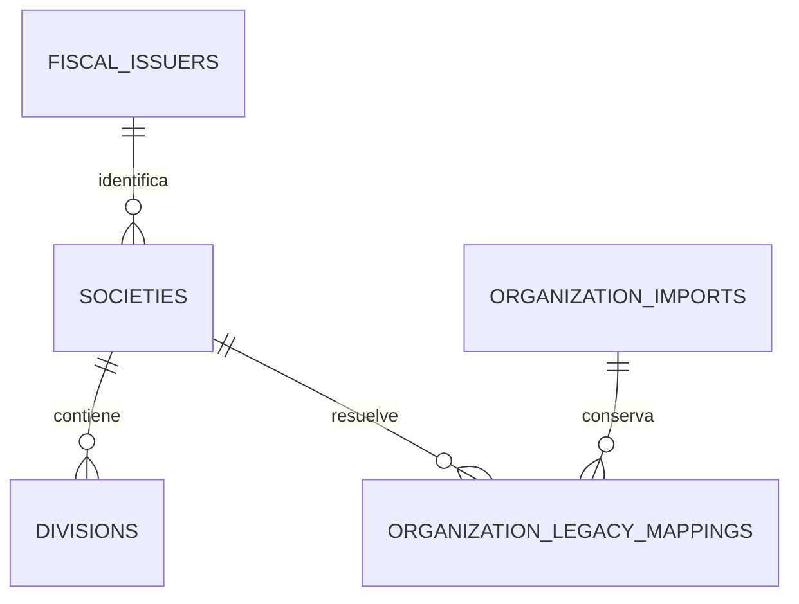

# CONT-01 — Estructura organizacional compatible

> Etapa histórica completada en CHG-289. Desde CHG-292, [CONT-02](cont_02_administracion_organizacional.md) implementa el switch revisado, APIs y UI en Local. Las afirmaciones de autoridad JSON y pantallas pendientes de este documento describen exclusivamente el estado anterior al switch.

**Cambio:** CHG-289. **Fecha:** 2026-09-22. **Ambiente:** sólo Local.

**Decisiones:** [CONT-00 cerrado](cont_00_decisiones_y_preflight.md).

**Revisión:** `20260922_0037`, posterior a `20260913_0036`.

## Alcance y aceptación

El usuario definió Emisor 1:N Sociedad 1:N División 1:N Centro de costos, un único Emisor por Sociedad y libros a nivel Sociedad. La moneda base se configura por Sociedad/libro, inicialmente MXN; las futuras transacciones permiten otra moneda con tipo de cambio capturado. Centro de costos obligatorio, dado de alta desde Administración por División y seleccionado según la División activa del usuario.

Este corte implementa exclusivamente persistencia organizacional y la importación compatible: modelos Admin, migración, equivalencias, preflight, backfill con revisión, auditoría, idempotencia y pruebas PostgreSQL. Aceptación: IDs/códigos conservados mediante equivalencias; referencias internas con tenant; ningún dato fiscal inventado; original intacto; repetición sin duplicados; cambio de origen/destino detectado; downgrade protegido.

Los formularios y APIs normalizados son CONT-02, sesión/scopes CONT-03, Centros de costos CONT-05, asignaciones de maestros CONT-07 y transacciones CONT-08. Accounting permanece `planned`. Ninguna pantalla actual cambia con este corte.

## Modelo implementado



| Tabla de Admin | Datos y restricciones |
|---|---|
| `fiscal_issuers` | PK tenant/id, código único por tenant, razón social, datos fiscales opcionales heredados, contacto JSONB y estado. No declara preparación fiscal por estar migrado. |
| `societies` | PK tenant/id, código/nombre, `issuer_id` obligatorio con FK compuesta al mismo tenant, `base_currency` inicialmente MXN, estado. Varias Sociedades pueden apuntar al mismo Emisor. |
| `divisions` | PK tenant/id, código/nombre, `society_id` obligatorio con FK compuesta, domicilio/teléfono y estado. |
| `organization_imports` | Un snapshot preparado por tenant durante esta fase: hashes del origen/plan, JSONB completo, resoluciones explícitas, operador, correlación y timestamps. |
| `organization_legacy_mappings` | PK tenant/colección/ID legado. Referencias al lote y a Sociedad/Emisor o Sociedad/División, con FKs compuestas que impiden inconsistencias de pertenencia. Conserva cada objeto original completo. |

Las tablas son de Admin y no contienen FKs hacia otros schemas. Se incluyen índices por tenant/estado y tenant/padre. Los IDs nuevos son deterministas a partir de tenant, tipo e ID legado; las colisiones de PK/UK abortan la transacción. Los códigos existentes de Sociedad/Sucursal se conservan. Cuando faltan, la regla específica de migración asigna `SOC-MIG-`, `DIV-MIG-` o `EMI-MIG-` con sufijo determinista; las altas normales usarán las secuencias del corte CONT-06. No se renumeran registros antiguos.

Cada razón social genera inicialmente una Sociedad y un Emisor. Compartir un Emisor requiere un alias explícito hacia una razón social canónica, con RFC y datos fiscales compatibles. No se fusionan Sociedades por RFC. No existe `society_issuers` ni una lista de Emisores por Sociedad.

## Compatibilidad y fallos parciales

`organization.profile` sigue siendo la autoridad del runtime actual. El backfill crea una copia normalizada preparada, sin redirigir lecturas ni habilitar escrituras por API. Los objetos originales, incluidos contactos/extensiones, quedan en el JSON operativo y en el snapshot del lote/mapeo.

No hay sincronización automática de nuevos cambios del JSON en este corte. Antes de activar CONT-02 es obligatorio reconciliar cualquier cambio posterior del origen y definir el switch de escritores/lectores. Un rerun no sobrescribe las tablas si el origen o el destino cambió: devuelve un conflicto. Esto evita dos autoridades activas o una supuesta sincronización que pierda datos.

Un snapshot importado por tenant es el límite deliberado de la fase de expansión. La actualización incremental y proyección compatible son parte del switch, no una función implícita del CLI. Las sucursales sintéticas de fallback de sesión no se materializan como Divisiones si no existen en el JSON original.

## Operación Local

Script: [organization_backfill_local.py](../../backend/scripts/organization_backfill_local.py). Requiere `ERCLAVE_ENVIRONMENT=local` y `ERCLAVE_DATABASE_URL` explícita a loopback, puerto 5434, base `erclave_local`, sin parámetros de conexión que puedan sustituir host/service. No carga `.env` automáticamente. El comando sólo admite el tenant autorizado `ten_739ee59d765d5e14818674800d`.

El `.env` actual también tiene una variable dirigida a `erclave_qa`; no se debe cargar como configuración general. Esta ejecución seleccionó y validó exclusivamente `ERCLAVE_INVENTORY_DATABASE_URL` Local y la pasó al proceso. No registrar URLs con credenciales.

Vista previa por defecto, transacción `READ ONLY`:

```powershell
backend/.venv/Scripts/python.exe backend/scripts/organization_backfill_local.py --tenant-id ten_739ee59d765d5e14818674800d
```

Devuelve conteos, IDs de equivalencia, códigos/estados de destino, moneda base y hashes. No imprime nombres, RFC, contactos, contraseñas ni contenido del perfil. Un error devuelve código estable y, cuando aplica, rutas estructuradas. La conexión fija también `hostaddr` a loopback y limita la espera de locks a cinco segundos.

Para resolver duplicados fiscales o referencias huérfanas se admite un archivo JSON explícito, revisado junto con el plan:

```json
{
  "issuer_aliases": {"legacy_legal_b": "legacy_legal_a"},
  "branch_societies": {"legacy_branch": "legacy_legal_a"}
}
```

Los IDs son ejemplos; no se usa ese archivo contra datos reales. Agregar `--resolutions ruta/al/archivo.json` tanto en preview como al aplicar. No se permiten referencias desconocidas, ciclos de alias, RFC incompatibles o diferencias fiscales ocultas.

Aplicación de un plan concreto ya revisado:

```powershell
backend/.venv/Scripts/python.exe backend/scripts/organization_backfill_local.py --tenant-id ten_739ee59d765d5e14818674800d --apply --expected-source-hash HASH_ORIGEN --expected-plan-hash HASH_PLAN --operator OPERADOR
```

Una transacción realiza: lock por tenant → lock del JSON original → validación de ambos hashes → comprobación del destino y moneda MXN activa en Admin → lote/entidades/equivalencias → auditoría. Un fallo revierte todo. El segundo intento idéntico responde `already_applied` sólo después de comparar los valores efectivos del destino. Un perfil sin entidades devuelve `empty` y no crea lotes ni datos artificiales.

El operador del CLI queda como actor técnico en auditoría; no se simula un usuario autenticado. Este script no es una API pública ni reemplaza permisos del futuro formulario.

## Migración, rollback y validación

- Upgrade de DDL sin backfill automático: crea las cinco tablas y constraints. Se aplicó a Local desde `0036` hasta `0037` con Alembic canónico.
- Downgrade: toma locks exclusivos; se niega si cualquiera de las cinco tablas contiene datos. Si están vacías, elimina sólo esas tablas. Si ya hubo importación, mantenerlas sin activar hasta un procedimiento explícito de conservación/reconciliación; nunca borrar un backfill para forzar downgrade.
- Se probaron upgrade/downgrade/re-upgrade dentro de una transacción y se compararon tipos/nulabilidad de modelos contra PostgreSQL.
- Las pruebas usan únicamente el tenant permitido. Los cambios sintéticos al perfil, catálogo y tablas se revierten al terminar; no se crean tenants adicionales ni se limpian tablas ajenas.
- El aislamiento se verifica mediante IDs por tenant en pruebas puras, FKs compuestas inspeccionadas en PostgreSQL, referencias ausentes y pertenencias incompatibles rechazadas. No se atribuye UAT con dos cuentas/tenants reales.
- Concurrencia: una segunda conexión no obtiene el lock del mismo tenant mientras la primera importación mantiene su transacción. Reintento idempotente, alteración de origen/destino y fallo durante auditoría tienen cobertura.

Evidencia Local: el perfil autorizado tenía cero razones sociales y cero sucursales antes y después. El preview posterior devuelve cero entidades/equivalencias; no se ejecutó backfill sobre un conjunto real no vacío. Las pruebas de conversión usaron fixtures transaccionales, conservando códigos, estados, contactos y extensiones. PostgreSQL quedó en `20260922_0037`; QA documentado permanece `e57237f/20260913_0036` sin consulta nueva.

Pruebas focalizadas: 51 aprobadas, cero omitidas (30 del corte nuevo, incluidas 9 PostgreSQL, y 21 del preflight previo). Gate `npm.cmd run verify` aprobado: todos los validadores, compilación y 355 pruebas backend/67 omitidas en la corrida sin DB; las 9 integraciones nuevas pasaron en la corrida focalizada, las 58 previas no se reejecutaron con DB. Evidencia en [TRAZABILIDAD](../../TRAZABILIDAD.md). Sin browser/UAT nueva, seeds, Firebase o despliegues.

## APIs afectadas

Ninguna. No se modificaron OpenAPI, payloads ni permisos y no se invocaron endpoints. Los endpoints de razones sociales, sucursales y sesión mantienen su comportamiento actual. El cambio afecta modelos/migración/herramienta interna y documentación; la configuración visible solicitada se implementa en los siguientes cortes.
