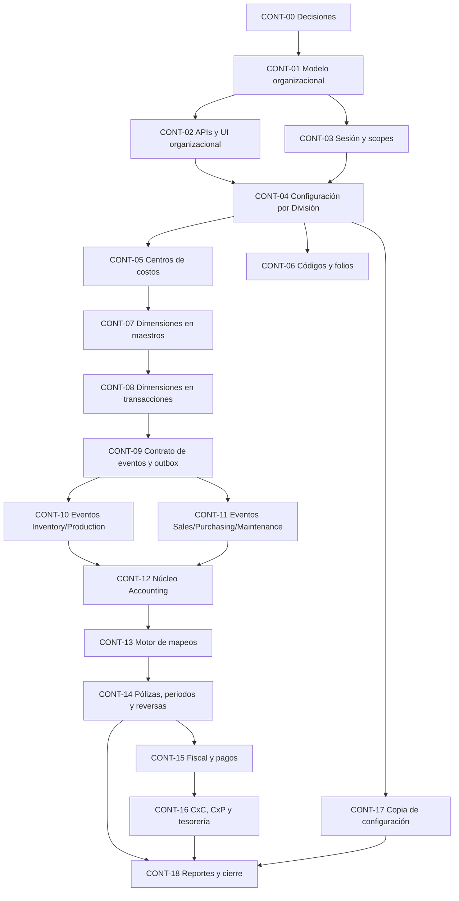

# ERClave — Plan de trabajo para estructura organizacional, costos y contabilidad

## Preparacion CC-19 - CHG-326

El usuario aun no cuenta con datos/equivalencias reales. [Guia de mapeos y configuracion opcional](cc19_mapeos_y_configuracion_contable.md) contiene el diagrama, insumos por dueño, preflight y roles de cuentas futuros. CC-19 no tiene backfill aprobado; Accounting sigue planned y apagado. Este plan conserva la secuencia de implementacion, mientras la guia sirve para reunir las decisiones de la empresa.

## Actualizacion CONT-08 - CHG-325

CC-21 implementado solo en Local: Production confirma costo estimado por Division en moneda base de Sociedad; Sales requiere tasa explicita cuando difiere la moneda de cotizacion y conserva snapshot final al aprobar. Sin costo o tasa confiables, estimado/margen quedan nulos sin bloquear aprobacion. Migracion 0062 sin backfill, historia preservada. Datos CC-19, aceptacion CC-20, QA y Accounting permanecen pendientes. Los apartados siguientes son historia de sus cortes.

## Actualizacion CONT-06 - CHG-323

El alcance de folios CC-18 descrito abajo se implemento solo en Local: Puestos RH, movimientos Inventory, proveedores/requisiciones/ordenes/recepciones Purchasing y ordenes Maintenance usan Admin. Movimientos internos en modo manual derivan codigo estable del origen. La migracion 0061 conserva historia sin renumerar. CC-19/20 y QA siguen pendientes. El texto de tareas mas abajo conserva el plan original.

## Estado y fuentes de vigencia

La conciliación por submódulo vive en [CONTROL_CONTABLE](../contexto/CONTROL_CONTABLE.md); [ESTADO_ACTUAL](../contexto/ESTADO_ACTUAL.md) distingue Local de QA y [PENDIENTES](../contexto/PENDIENTES.md) fija la continuación. Evidencia de cada corte en [TRAZABILIDAD](../../TRAZABILIDAD.md). No sumar pendientes históricos como trabajo nuevo.

Organización/sesión, [centros CONT-05](cont_05_catalogo_centros.md), asignaciones CONT-07 y [condiciones explícitas sin herencia](cont_07_commercial_condiciones.md) ya están implementados Local. CONT-04 es parcial y CONT-06 sigue abierto. CONT-08 conserva [cotización](cont_08_cotizaciones_contexto.md) → [pedido](cont_08_pedidos_contexto.md), [servicios](cont_08_servicios_contexto.md), [stock/entrega y movimientos manuales](cont_08_stock_contexto.md). [Producción CHG-313](cont_08_produccion_contexto.md) conecta órdenes manuales por División e Inventory sobre la preparación CHG-308 (gates técnicos aprobados; aceptación integrada pendiente); CHG-314 adapta moneda de Servicios. [Fabricación desde pedidos CC-12](cont_08_fabricacion_contexto.md) implementada CHG-315 con recorrido HTTP real aprobado.

Política CHG-309 confirmada: costos y tarifas en moneda base de Sociedad; documento en otra moneda conserva original, tasa explícita y convertido. Servicios CHG-314 y [productores Inventory CC-14 CHG-317](cont_08_inventario_productores.md) adaptados Local; [Compras CC-15 CHG-319](cont_08_compras_contexto.md) implementado Local; separación de Mantenimiento continúa CC-16. No reinterpretar historia. Analítica Costing y Accounting permanecen planned. Datos reales y aceptación integrada siguen abiertos; estos cortes no fueron promovidos a QA.

## 1. Resultado esperado

ERClave debe poder explicar, para cualquier movimiento económico:

- qué ocurrió;
- en qué Corporativo, Sociedad y División ocurrió;
- qué Centro de costos recibió el efecto;
- qué Emisor fiscal intervino;
- qué documento y línea originaron el movimiento;
- qué código estable identifica cada maestro y documento;
- qué cuentas se cargaron y abonaron;
- qué regla de mapeo se utilizó;
- si el movimiento fue revertido, compensado o sigue pendiente;
- quién realizó y autorizó cada acción.

La implementación se hará por cortes verticales pequeños. Cada corte debe dejar datos, API, permisos, frontend, pruebas y documentación alineados.

## 2. Definiciones de trabajo

Estas definiciones incorporan la decisión del usuario en CHG-289 y sustituyen las propuestas incompatibles de CHG-286/287.

| Concepto | Definición de trabajo |
|---|---|
| Corporativo | El `tenant` actual. Es la frontera de aislamiento, contratación y administración superior. |
| Sociedad | Unidad empresarial de gestión dentro del Corporativo. Tiene exactamente un Emisor, agrupa Divisiones y es dueña de su libro contable. |
| División | Unidad donde ocurre la operación: planta, sucursal, oficina, taller o unidad equivalente. Sustituye el concepto actual de Sucursal. |
| Emisor | Identidad fiscal con RFC/tax ID, razón social, régimen y domicilio fiscal. Puede asociarse a varias Sociedades del mismo Corporativo. |
| Centro de costos | Dimensión perteneciente a una División para acumular costos e ingresos de gestión. |
| Libro contable | Conjunto de cuentas, periodos y pólizas de una Sociedad con moneda base configurable, inicialmente MXN. División y Centro de costos conservan el detalle; Emisor se deriva de Sociedad. |
| Evento económico | Registro inmutable y versionado producido por un servicio operativo para informar un efecto susceptible de contabilización. |
| Mapeo contable | Regla versionada que convierte un evento en cargos y abonos. |
| Instrumento de pago | Medio interno concreto, por ejemplo `Visa Débito BBVA ****1234`, relacionado con una forma SAT y mapeos contables. |

## 3. Principios de ejecución

1. Mantener `tenant_id` en toda tabla y consulta operativa.
2. Una referencia entre servicios usa ID estable y validación por contrato; no usa FK entre schemas.
3. Cada servicio escribe exclusivamente sus datos.
4. Los documentos operativos son la fuente de verdad del hecho; Accounting registra su representación contable.
5. Los efectos contabilizados no se editan ni eliminan; se corrigen mediante reversa o evento compensatorio.
6. Los cambios persistentes siguen el patrón **expandir → migrar → exigir → retirar compatibilidad**.
7. Los maestros compartidos se separan de su activación por División para evitar duplicados.
8. Los datos derivados no se vuelven campos manuales.
9. Todo código visible de maestro o documento se asigna por la autoridad de folios de Admin o por una regla documentada.
10. Un mapeo faltante o ambiguo produce un pendiente visible; no selecciona cuentas silenciosamente.
11. Cada evento, copia y comando reintentable es idempotente.
12. Cada corte se prueba primero en Local aislado. QA requiere candidato y autorización de release independiente.

## 4. Estrategia de alcance por División

No todo dato necesita duplicarse por División. El plan distingue tres patrones.

### 4.1 Maestro compartido con asignación local

Se conserva una sola identidad y se crea una relación por División con parámetros locales.

| Maestro | Configuración por División |
|---|---|
| Artículo | Activo, Centro de costos de la División, obligatorio sólo por flujo de imputación habilitado, almacén sugerido, mínimo, máximo, política y costo local cuando aplique. |
| Producto/Servicio | Activo, precio/política, Centro de costos predeterminado y disponibilidad. |
| Puesto | Activo, capacidad, tarifa de costeo y Centro de costos predeterminado. |
| Cliente/Proveedor | Disponibilidad comercial y condiciones autorizadas por Sociedad/División. |
| Cuenta contable | Disponibilidad en libro y reglas de mapeo por alcance. |

### 4.2 Recurso perteneciente a una División

El recurso físico debe tener una sola División vigente:

- almacén;
- máquina;
- ubicación física;
- orden o documento una vez iniciada su operación.

Mover un recurso a otra División requiere una transición auditada y no reescribe documentos históricos.

### 4.3 Identidad corporativa con scope

Usuarios y roles no se clonan. La membresía define Sociedades y Divisiones autorizadas. Un trabajador puede tener asignaciones elegibles a una o varias Divisiones; cada registro de trabajo guarda la División efectiva.

## 5. Campos transversales que se agregarán

| Campo | Dónde aplica | Razón | Regla de captura |
|---|---|---|---|
| `division_ref_id` | Recursos y documentos operativos | Identificar dónde ocurrió la operación. | Selector del scope autorizado; obligatorio al crear. |
| `society_ref_id` | Eventos y snapshots contables | Preservar contexto de gestión e historia. | Derivado de División; no se captura por separado. |
| `cost_center_ref_id` | Consumos, ingresos, gastos, tiempos y eventos configurados | Asignar el efecto económico. | Predeterminado por configuración y editable sólo cuando la política lo permita. |
| `issuer_ref_id` | Documentos fiscales y snapshots de eventos | Preservar identidad fiscal. | Derivado del único Emisor de la Sociedad; no se captura como asociación alternativa. |
| `source_event_id` y `event_version` | Ingesta contable | Evitar duplicados y conservar evolución. | Generados por backend. |
| Snapshots de código/nombre | Eventos y documentos históricos | Mantener legibilidad ante cambios de maestros. | Generados por backend desde la referencia validada. |

Ningún formulario debe pedir al usuario `society_ref_id` cuando ya puede derivarse de `division_ref_id`.

## 6. Dependencias y ruta crítica

## 7. Plan detallado por corte

### CONT-00 — Cerrar reglas de negocio y criterios contables

**Objetivo:** eliminar ambigüedades que cambiarían el modelo persistente.

**Cambios/ajustes:**

1. Ratificar Sociedad como unidad de gestión y Emisor como identidad fiscal.
2. Libro por Sociedad con moneda base configurable, inicialmente MXN.
3. Un Emisor puede tener varias Sociedades; una Sociedad tiene exactamente un Emisor. No hay relación muchos-a-muchos.
4. Aplicar la política condicional confirmada en CHG-296: catálogo básico desde Administración, propiedad Costing; Centro de costos obligatorio sólo por flujo de imputación habilitado o cuenta que lo requiera. La operación sin imputación no exige centros por preparación. Sociedad se deriva de División; cada consumidor valida elegibilidad.
5. Diseñar y validar en los cortes contables los momentos de reconocimiento; esta propuesta no acredita reglas fiscales aprobadas ni runtime:
   - pedido/requisición/orden de compra: compromiso sin póliza;
   - entrega: costo de venta/inventario;
   - factura cliente: cuenta por cobrar, ingreso e impuestos;
   - recepción proveedor: inventario/gasto contra recepción no facturada;
   - factura proveedor: cuenta por pagar, impuestos y conciliación;
   - horas: costeo; pasivo sólo mediante futuro proceso de nómina.
6. Permitir moneda de transacción distinta de la base, tipo de cambio capturado y conversión contable a MXN inicialmente. Conservar importe original, tasa e importe base; aplicar Decimal y regla de redondeo versionada al implementar conversión.
7. Definir que transferencias entre Sociedades usarán un flujo intercompañía, no la transferencia simple de almacén.
8. Elegir configuraciones heredadas en vivo y configuraciones copiadas como snapshot.

**Entregables:** registro de decisiones, glosario aprobado, ejemplos de pólizas y casos límite.

**Criterio de salida organizacional cumplido:** cardinalidad Sociedad/Emisor, libro por Sociedad y moneda base definidos. Reconocimiento fiscal, políticas de activación y backfill real conservan decisiones específicas en sus cortes; no declararlas resueltas por cerrar CONT-00.

---

### CONT-01 — Normalizar la estructura organizacional

**Completado Local, etapa de expansión histórica.** El JSON como autoridad y rollback sin switch descritos abajo pertenecen a CHG-289. [CONT-02](cont_02_administracion_organizacional.md) ya implementa la autoridad normalizada tras activación por tenant.

**Objetivo:** sustituir el JSON como única fuente organizacional por entidades consultables y validables.

**Persistencia Admin:**

- `admin.societies`;
- `admin.divisions`;
- `admin.fiscal_issuers`;
- `admin.organization_imports` y `admin.organization_legacy_mappings`;
- índices y constraints por `tenant_id`;
- unicidad de códigos por tenant;
- una División pertenece a una Sociedad del mismo tenant;
- `societies.issuer_id` obligatorio conecta con un Emisor del mismo tenant;
- cada Sociedad guarda `base_currency`, inicialmente MXN; las nuevas tablas aún no sustituyen la autoridad del JSON.

**Migración de datos existentes:**

1. Ejecutar un preflight de solo lectura por tenant.
2. Por cada `legal_entity` actual, crear inicialmente:
   - una Sociedad;
   - un Emisor con sus datos fiscales;
   - su referencia al único Emisor; compartir Emisor entre Sociedades requiere resolución explícita de identidades legadas.
3. Convertir cada `branch` en División y relacionarla con la Sociedad derivada de `legal_entity_id`.
4. Si una sucursal no tiene razón social, exigir una resolución explícita hacia una Sociedad del mismo tenant; no inventar Sociedad ni RFC.
5. Guardar una tabla o evidencia de equivalencias `legacy_id → new_id`.
6. Conservar temporalmente `organization.profile` como autoridad operativa intacta y las tablas como snapshot preparado. El switch y la proyección compatible corresponden a CONT-02.
7. Comparar conteos, IDs, estados, asociaciones y contactos antes del switch.

**Rollback:** las tablas nuevas se pueden dejar sin activar; el JSON anterior permanece intacto durante la fase de expansión.

**Criterios de aceptación:**

- todos los registros actuales tienen equivalencia;
- no existe cruce de tenant;
- códigos e IDs son estables;
- el rerun no duplica datos;
- migración upgrade/downgrade e integración PostgreSQL aprobadas.

---

### CONT-02 — APIs y formularios de Sociedad, División y Emisor

**Objetivo:** administrar la nueva estructura sin sobrecargar los formularios.

**APIs implementadas en Local (CHG-292):**

- `GET/POST /v1/organization/societies`;
- `GET/PATCH /v1/organization/societies/{society_id}`;
- `POST /v1/organization/societies/{society_id}/activate|deactivate`;
- `GET/POST /v1/organization/divisions`;
- `GET/PATCH /v1/organization/divisions/{division_id}`;
- `POST /v1/organization/divisions/{division_id}/activate|deactivate`;
- `GET/POST /v1/organization/fiscal-issuers`;
- `GET/PATCH /v1/organization/fiscal-issuers/{issuer_id}`;
- Sociedad recibe su único `issuer_id` y `base_currency` en alta/edición; no existe endpoint para múltiples asociaciones.

**Permisos implementados en CONT-02:**

- `admin.society.read|create|update|status`;
- `admin.division.read|create|update|status`;
- `admin.fiscal_issuer.read|create|update|status`;
- La asignación del único Emisor se controla con la capacidad de alta/edición de Sociedad y validación de pertenencia.

**Contratos de formulario mínimos:**

| Formulario | Campos iniciales | Razón |
|---|---|---|
| Sociedad | código administrado, nombre, único Emisor, moneda base inicialmente MXN, estado en edición | Identidad de gestión y configuración de su libro. No duplica datos fiscales. |
| División | código, nombre, Sociedad, domicilio/contacto existentes, estado | Ubicación y alcance operativo. |
| Emisor | código, razón social, RFC, régimen, CP/país fiscal, estado | Identidad fiscal suficiente para preparar CFDI. |
| Centro de costos (CONT-05, en Administración) | código, nombre, División y estado en edición | Identificar la afectación dentro de la División; Sociedad derivada, sin doble captura. |

**Compatibilidad:** los endpoints actuales `legal-entities` y `branches` se mantienen deprecados durante el switch y no se eliminan hasta migrar todos los consumidores.

**Pruebas:** alta/edición/lectura, duplicados, referencias cruzadas de tenant, inactivación con dependencias, idempotencia, permisos e i18n.

---

### CONT-03 — Sesión, usuario activo y scopes

Implementado Local en CHG-293: [contrato, conversión y límites](cont_03_sesion_alcances.md). No equivale a separación de documentos, que corresponde a CONT-07/08.

**Objetivo:** convertir la División en una frontera operativa validada por backend.

**Cambios:**

- ampliar `GET /v1/session/context` con Sociedades, Divisiones y Emisores visibles;
- sustituir `branch_ids` por un scope versionado con `society_ids` y `division_ids`;
- migrar metadata de membresías mediante la tabla de equivalencias;
- habilitar edición de alcance en Administración;
- agregar selector de Sociedad/División activa;
- conservar la selección local sólo como preferencia; cada API vuelve a validar;
- invalidar una selección inactiva o fuera del scope;
- mantener compatibilidad temporal para clientes que lean `branches`.

**Reglas:**

- `X-Tenant-Id` no concede acceso;
- el usuario con todas las divisiones conserva un wildcard explícito;
- una División nueva no amplía automáticamente scopes restringidos;
- el owner puede recibir todas las divisiones según política documentada.

**Criterios:** pruebas con owner, usuario restringido, División inactiva, IDs de otro tenant y cambios concurrentes de membresía.

---

### CONT-04 — Infraestructura de configuración por División

**Objetivo:** permitir diferencias locales sin duplicar maestros.

**Cambios:**

- definir un contrato común de scope: `corporate`, `society`, `division`;
- crear tablas de asignación en cada servicio propietario;
- definir precedencia Corporativo → Sociedad → División;
- devolver `resolved_from_scope` y `override` en lecturas administrativas;
- guardar el valor resuelto en snapshots de transacciones;
- rechazar empates o referencias incompatibles;
- crear endpoints de referencias elegibles por módulo.

**Regla de frontend:** cada pantalla consume referencias a través de la API de su módulo; el backend revalida contra el servicio dueño.

**Criterios:** herencia visible, override reversible, inactivación segura, valor histórico conservado y ausencia de escrituras cruzadas.

---

### CONT-05 — Catálogo de Centros de costos

**Implementado Local CHG-297:** [contrato, autorización y evidencia](cont_05_catalogo_centros.md). Conservar este catálogo; los criterios siguientes no son un encargo para volver a implementarlo.

**Superficie solicitada:** alta/edición claramente localizada en Administración. Costing conserva ownership técnico del catálogo y Admin lo orquesta por contrato. Los formularios operativos muestran un selector obligatorio con centros activos de la División autorizada del usuario; una opción de otra División se rechaza en backend. No duplicar el catálogo ni escribir el schema de Costing desde Admin.

**Objetivo:** crear la dimensión estable que reemplaza textos libres.

**Persistencia Costing:**

- `costing.cost_centers` con `tenant_id`, `id`, `code`, `name`, `division_ref_id`, estado y vigencia;
- snapshots de Sociedad/División para lectura histórica si el contrato lo requiere;
- sin jerarquía padre/hijo en el primer corte.

**APIs propuestas:**

- `GET/POST /v1/cost-centers`;
- `GET/PATCH /v1/cost-centers/{cost_center_id}`;
- `POST /v1/cost-centers/{cost_center_id}/activate|deactivate`;
- `GET /v1/cost-centers/eligible?division_id=...`.

**Permisos:** `costing.cost_center.read|create|update|status`.

**Formulario:** código administrado, nombre, División y estado en edición. Descripción, responsable y jerarquía se difieren hasta que exista una tarea concreta.

**Criterios:** pertenencia tenant/División, código único, valor inactivo conservado en historia y bloqueo de uso nuevo.

---

### CONT-06 — Cerrar códigos y folios faltantes

**Objetivo:** asegurar identidad visible uniforme antes de generar eventos contables.

**Cambios de Admin/code sequences:**

- activar el uso real de `hr.position`;
- alinear `inventory.movement` con su secuencia;
- agregar secuencias para `purchasing.supplier`, `purchasing.requisition`, `purchasing.order`, `purchasing.receipt` y `maintenance.order`;
- conservar secuencias ya implementadas de Sociedad, División, Emisor y Centro de costos; instrumento de pago corresponde al corte futuro que lo implemente;
- definir modo administrado/manual e idempotencia por tipo;
- migrar folios existentes sin renumerarlos.

**Cambios por servicio:**

- HR agrega `code` a Puesto y lo conserva en snapshots;
- Inventory solicita el folio antes de crear el movimiento y elimina la generación aleatoria para movimientos nuevos;
- Purchasing y Maintenance dejan el campo editable cuando el modo sea administrado;
- cada servicio conserva unicidad y validación local.

**Criterios:** concurrencia sin duplicados, reintento estable, modo manual funcional y documentos históricos intactos.

---

### CONT-07 — Dimensionar maestros y recursos

**Asignaciones implementadas Local CHG-298–302.** Inventory, Production, RH, Sales y Purchasing ya tienen sus recorridos. Datos reales, moneda de tarifas y consumidores operativos son brechas separadas de [CC-03–06/10/19](../contexto/CONTROL_CONTABLE.md); no duplicar los maestros ni reabrir asignaciones.

**Objetivo:** establecer dónde está disponible cada maestro antes de dimensionar transacciones.

**Cambios por dominio:**

| Dominio | Ajuste |
|---|---|
| Inventory | Almacén recibe `division_ref_id`; `business_center` queda como snapshot temporal y después se retira. Artículo conserva maestro y agrega asignaciones por División con Centro de costos seleccionado en el contexto activo, obligatorio sólo por flujo de imputación habilitado (CHG-296). |
| Production | Máquina pertenece a División. Producto/Servicio conserva maestro y agrega asignación con Centro de costos predeterminado. |
| HR | Puesto conserva maestro y agrega activación/tarifa por División. Trabajador agrega elegibilidad o adscripción por División. |
| Sales | Cliente conserva identidad; se agregan asociaciones comerciales permitidas por Sociedad/División. |
| Purchasing | Proveedor conserva identidad; se agregan asociaciones permitidas por Sociedad/División. |

**Migración:** campos nuevos primero nulos, reporte de faltantes, backfill aprobado, validación y finalmente `NOT NULL` donde aplique.

**Criterios:** ningún recurso físico queda sin División; maestros compartidos no se duplican; selectores sólo ofrecen referencias elegibles.

---

### CONT-08 — Dimensionar documentos y transacciones

**Objetivo:** hacer que cada operación nueva guarde una División y el Centro de costos efectivo.

**Documentos afectados:**

- movimientos, reservas, transferencias y recepciones de Inventory;
- recetas, órdenes, consumos, avances y recepciones de Production;
- cotizaciones, pedidos, entregas y órdenes de servicio de Sales;
- requisiciones, órdenes y recepciones de Purchasing;
- órdenes, tiempos y materiales de Maintenance.

**Reglas comunes:**

- División obligatoria al crear;
- Sociedad derivada y validada;
- Centro de costos obligatorio sólo por flujo de imputación habilitado, seleccionado entre los de la División activa; un predeterminado debe mostrarse y validarse, nunca guardar un centro ajeno al scope;
- División inmutable después de la primera transición/efecto;
- referencias relacionadas compatibles con el mismo scope;
- snapshot de códigos/nombres;
- datos existentes reciben backfill explícito.

**Casos especiales:**

- transferencia entre almacenes de la misma Sociedad puede cambiar División;
- transferencia entre Sociedades se rechaza y dirige al futuro flujo intercompañía;
- una devolución conserva dimensiones del documento origen salvo ajuste autorizado y auditado.

**Criterios:** pruebas de alta/edición/lectura, referencias cruzadas, scopes, inmutabilidad y datos históricos.

---

### CONT-09 — Contrato de eventos económicos y outbox

**Objetivo:** crear la columna vertebral entre operación, Costing y Accounting.

**Contrato de evento:**

- `event_id`, `event_type`, `schema_version`;
- `occurred_at`, `recorded_at`;
- tenant, Sociedad, División, Centro de costos y Emisor condicional;
- servicio/documento/línea origen con ID y código;
- moneda, tipo de cambio, cantidades, importes e impuestos;
- contraparte cuando aplique;
- dirección económica y motivo tipificado;
- snapshots;
- `reversal_of_event_id`;
- correlación e idempotencia.

**Infraestructura:**

- tabla outbox en cada schema productor o helper técnico compartido sin reglas de negocio;
- publicación asíncrona;
- reintentos con backoff;
- dead letter/pending visible;
- consumidor idempotente;
- versionado compatible;
- métricas de edad y fallos.

**Criterios:** commit operativo y outbox atómicos, evento publicado una o más veces sin doble efecto, replay seguro y trazabilidad completa.

---

### CONT-10 — Eventos de Inventory y Production

**Objetivo:** cubrir primero los movimientos con mejor base operativa actual.

**Inventory emite:**

- `inventory.receipt.recorded`;
- `inventory.issue.recorded`;
- `inventory.adjustment.positive|negative`;
- `inventory.transfer.recorded`;
- `inventory.movement.reversed`;
- tipos explícitos para merma, devolución y diferencia.

**Production emite:**

- `production.material.issued|returned`;
- `production.labor.consumed`;
- `production.machine.consumed`;
- `production.finished_goods.received`;
- `production.scrap.recorded`;
- `production.variance.recorded`;
- reversas/compensaciones relacionadas.

**Ajustes funcionales:** tipificar motivo de merma/ajuste; guardar puesto/tarifa y máquina/costo efectivos; no recalcular historia con valores actuales.

**Criterios:** reconciliación evento–documento–movimiento, importes balanceables, replay y reversa.

---

### CONT-11 — Eventos de Sales, Purchasing y Maintenance

**Objetivo:** completar costos comerciales, abastecimiento y mantenimiento disponibles.

**Sales:**

- entrega confirmada y costo real;
- consumo de tiempo/costo en orden de servicio;
- cancelación o devolución cuando exista el documento correspondiente.

**Purchasing:**

- recepción de inventario;
- recepción de servicio/gasto;
- cancelación o devolución cuando exista el flujo correspondiente.

**Maintenance:**

- refacción emitida/devuelta;
- tiempo consumido con código de puesto, tarifa, costo y Centro de costos;
- clasificación de gasto, producción en proceso o capitalizable mediante política.

**Criterios:** ningún evento se genera al cotizar o solicitar; se genera en el momento operativo aprobado en CONT-00.

---

### CONT-12 — Núcleo de Accounting

**Objetivo:** implementar las entidades base sin publicar todavía contabilización automática completa.

**Persistencia Accounting:**

- `ledgers`;
- `chart_accounts`;
- `accounting_periods`;
- `source_events`;
- `journal_entries`;
- `journal_lines`;
- `mapping_rules` y versiones;
- `accounting_attachments` o referencias seguras a anexos;
- auditoría e idempotencia.

**APIs iniciales:**

- libros y catálogo de cuentas;
- periodos: abrir, cerrar y reabrir con permiso elevado;
- consulta de eventos recibidos;
- consulta de asientos y líneas;
- sin edición destructiva de asientos contabilizados.

**Permisos:**

- `accounting.ledger.*`;
- `accounting.account.*`;
- `accounting.period.read|open|close|reopen`;
- `accounting.journal.read`;
- `accounting.source_event.read`.

**Reglas:** cuenta con naturaleza, tipo, jerarquía, estado y `requires_cost_center`; código único por libro; líneas siempre pertenecen al tenant/libro correcto.

---

### CONT-13 — Motor de mapeos

**Objetivo:** resolver cuentas de manera determinista y auditable.

**Cambios:**

- editor de reglas con evento, scope, filtros, roles de débito/crédito, vigencia y prioridad;
- jerarquía de búsqueda de mayor a menor especificidad;
- detección de empate;
- simulación de mapeo antes de activar;
- versión inmutable de regla usada;
- bandeja de evento sin mapeo, mapeo inválido o dimensión faltante;
- reproceso idempotente.

**Mapeos iniciales:** inventario, recepción, consumo productivo, producto terminado, costo de venta, merma, mantenimiento y tiempo/costo de servicio.

**Criterios:** misma entrada y versión producen el mismo resultado; una ambigüedad no genera póliza; cambios nuevos no alteran asientos anteriores.

---

### CONT-14 — Pólizas, periodos, reversas y cierre

**Objetivo:** convertir eventos resueltos en contabilidad de doble partida.

**Cambios:**

- generación de asiento balanceado;
- estados `draft`, `posted`, `reversed` y `pending_mapping` donde correspondan;
- folio de póliza por libro/periodo;
- validación de periodo abierto;
- moneda base de Sociedad (inicial MXN), importe/moneda original, tipo de cambio positivo capturado e importe base; congelar tasa y redondeo utilizados, sin convertir historia con configuración actual;
- anexos y documento origen;
- contabilización idempotente;
- reversa total ligada al asiento original;
- asiento de ajuste separado;
- conciliación entre evento y póliza.

**Decisión operativa:** si un evento llega con periodo cerrado, debe quedar pendiente o entrar al siguiente periodo mediante una política explícita; nunca se cambia de fecha silenciosamente.

**Criterios:** cargos igualan abonos, no hay doble contabilización, la reversa conserva historia y el cierre impide postings no autorizados.

---

### CONT-15 — Catálogos fiscales e instrumentos de pago

**Objetivo:** separar condiciones comerciales, claves SAT e instrumentos internos.

**Admin incorpora:**

- catálogo versionado de `c_FormaPago`;
- catálogo versionado de `c_MetodoPago`;
- instrumento interno con código, nombre, tipo, forma SAT, moneda, scope, referencia enmascarada, estado y vigencia;
- validación de fuente oficial y vigencia;
- sin almacenar credenciales bancarias.

**Accounting incorpora:**

- mapeo de instrumento a cuenta bancaria/caja/clearing;
- mapeo de comisión e impuestos asociados;
- reglas por Emisor/Sociedad/División.

**Regla fiscal:** `04` es tarjeta de crédito y `28` tarjeta de débito. PUE/PPD pertenecen al método, no al instrumento.

**Criterios:** un instrumento inactivo se conserva en documentos históricos y no se ofrece en nuevas capturas; forma y método se validan por vigencia y tipo de comprobante.

---

### CONT-16 — Facturación, CxC, CxP y movimientos de dinero

**Objetivo:** completar la contabilidad financiera que los eventos operativos por sí solos no cubren.

**Sales:**

- factura/CFDI de ingreso;
- nota de crédito y devolución;
- cuenta por cobrar;
- cobro y aplicación;
- reembolso;
- complemento de pago cuando aplique.

**Expenses/Purchasing:**

- factura/XML proveedor;
- conciliación orden–recepción–factura;
- gasto directo;
- cuenta por pagar y vencimientos;
- nota/devolución de proveedor;
- pago y aplicación.

**Accounting:** consume esos eventos y genera impuestos, cartera, proveedores, bancos y resultados. No crea la factura operativa.

**Criterios:** saldo por documento, aplicaciones parciales, sobrepago controlado, cancelación/reversa, moneda/tipo de cambio, permisos y conciliación.

---

### CONT-17 — Copia y plantillas de configuración

**Objetivo:** configurar varias Sociedades/Divisiones con rapidez y control.

**Entidad de orquestación:** `configuration_copy_job` con origen, destinos, recursos, modo de conflicto, snapshot, actor, idempotencia, estado y resultado.

**Recorrido:**

1. seleccionar origen y destinos;
2. elegir tipos de configuración;
3. ejecutar vista previa;
4. resolver conflictos;
5. confirmar;
6. cada servicio aplica exclusivamente sus datos;
7. mostrar resultado por elemento y permitir reintento seguro.

**Copiable inicialmente:**

- asignaciones de artículos/productos;
- políticas locales;
- activación y tarifas de puestos;
- Centros de costos equivalentes mediante mapeo explícito;
- reglas contables;
- perfiles de permisos/scope sin clonar usuarios.

**Revisión obligatoria:** almacenes, máquinas, domicilios, cuentas bancarias e instrumentos físicos no se activan automáticamente sin datos propios del destino.

**Criterios:** dry run exacto, conflictos visibles, repetición sin duplicados, auditoría y aislamiento.

---

### CONT-18 — Reportes, reconciliación y cierre del programa

**Objetivo:** demostrar que la información operativa, de costos y contable coincide.

**Reportes mínimos:**

- balanza y auxiliares por Sociedad/libro, con Emisor como referencia fiscal;
- mayor por cuenta;
- pólizas por periodo;
- movimientos por Sociedad, División y Centro de costos;
- costo estimado frente a real;
- eventos pendientes, fallidos y sin mapeo;
- conciliación documento → evento → póliza;
- ingresos, costos, mermas y mantenimiento por dimensión.

**Controles de cierre:**

- cero eventos duplicados;
- pendientes explicados y asignados;
- cuentas balanceadas;
- documentos contabilizados reconciliados;
- accesos por scope verificados;
- evidencia de migración y backfill;
- manuales y matriz QA actualizados.

## 8. Plan de migración transversal

Cada cambio persistente debe seguir cuatro despliegues lógicos, aunque varios puedan formar parte del mismo programa controlado.

### Paso A — Expandir

- crear tablas/campos nulos e índices compatibles;
- desplegar lectores que toleran dato anterior y nuevo;
- agregar auditoría y métricas;
- no exigir todavía la nueva dimensión.

### Paso B — Migrar

- ejecutar preflight de conteos y ambigüedades;
- crear equivalencias;
- backfill idempotente en lotes;
- emitir reporte por tenant;
- resolver manualmente excepciones documentadas.

### Paso C — Exigir

- cambiar escrituras para requerir División y referencias válidas;
- agregar constraints `NOT NULL` y unicidad;
- activar validación de scope y pertenencia;
- cambiar UI y contratos.

### Paso D — Retirar compatibilidad

- dejar de escribir JSON/campos libres antiguos;
- retirar endpoints deprecados cuando no tengan consumidores;
- conservar snapshots históricos;
- documentar rollback y fecha de retiro.

## 9. Estrategia de pruebas

### Por cada corte

- schemas y OpenAPI;
- repositorio y reglas de dominio;
- migración upgrade/downgrade cuando aplique;
- PostgreSQL real para constraints, concurrencia e idempotencia;
- permisos y entitlement;
- aislamiento entre dos tenants;
- referencias de otro scope;
- reintento con la misma y distinta huella;
- alta, edición, lectura tras recarga e historial;
- textos ES/EN y responsive cuando cambie UI;
- documentación y trazabilidad.

### Casos contables obligatorios

- cargo y abono balanceados;
- evento duplicado;
- evento fuera de orden;
- mapeo faltante;
- dos mapeos con la misma prioridad;
- cuenta inactiva;
- Centro de costos de otra División;
- periodo cerrado;
- reversa y doble reversa;
- moneda extranjera y redondeo;
- devolución parcial y total;
- transferencia entre Divisiones y rechazo entre Sociedades;
- replay de outbox.

## 10. Seguridad y auditoría

- todo comando recibe tenant y actor del contexto autorizado;
- las asociaciones se validan en backend;
- los permisos nuevos son puntuales y no se conceden por nombre de rol;
- cerrar/reabrir periodo, contabilizar manualmente, revertir y cambiar mapeos son acciones de riesgo alto;
- cada cambio de mapeo, periodo, cuenta, Emisor y scope registra antes/después;
- instrumentos guardan referencias enmascaradas y nunca secretos;
- anexos conservan acceso privado, caducidad y auditoría según su tipo;
- cada error operativo entrega `correlation_id` y `error.code` estable.

## 11. Observabilidad operativa

Métricas mínimas:

- eventos creados, publicados, procesados, duplicados y fallidos;
- edad del evento más antiguo sin contabilizar;
- eventos pendientes por causa;
- tiempo de resolución de mapeo;
- pólizas generadas y revertidas;
- diferencias de conciliación;
- trabajos de copia ejecutados, parciales y fallidos;
- errores de pertenencia y scope;
- backfill procesado/restante por tenant.

## 12. Hitos de producto

| Hito | Cortes | Capacidad entregada |
|---|---|---|
| H0 Decisiones organizacionales cerradas | CONT-00 | Modelo organizacional aprobado; ejemplos y reconocimiento contable se validan en los cortes futuros. |
| H1 Organización normalizada | CONT-01 a CONT-04 | Sociedad, División, Emisor, sesión y configuración con scope. |
| H2 Costos identificables | CONT-05 a CONT-08 | Centros, códigos y documentos dimensionados. |
| H3 Trazabilidad económica | CONT-09 a CONT-11 | Eventos y reversas desde los módulos actuales. |
| H4 Contabilidad operativa | CONT-12 a CONT-14 | Cuentas, periodos, mapeos y pólizas auditables. |
| H5 Contabilidad financiera | CONT-15 y CONT-16 | Fiscal, CxC, CxP, cobros y pagos. |
| H6 Escalamiento y cierre | CONT-17 y CONT-18 | Copia de configuración, reportes y conciliación final. |

## 13. Prioridad y alcance recomendado

La continuación vigente está en [CONTROL_CONTABLE](../contexto/CONTROL_CONTABLE.md). Preservar CHG-313/314/315 y CC-12 implementado: pedido→fabricación→entrega/costo; preservar fuentes CC-10, alta manual/recursos/terminado CC-11 y adaptación monetaria de Servicios CC-08. Luego CC-14/15/16: otros productores Inventory, documentos Compras y Mantenimiento. Completar CC-17/18 configuración/impresión/folios, CC-19 datos reales y CC-20 aceptación.

Preservar CONT-01/02/03/05, asignaciones CONT-07 y recorridos CONT-08 ya comprobados. CONT-04 sigue parcial y CONT-06 incompleto. CONT-09–18 son etapas posteriores de eventos, contabilidad, fiscal/cartera, copia y reportes; no condicionan cerrar separación operativa con Accounting apagado.

## 14. Definition of Done de cada corte

Un corte termina cuando:

- su criterio funcional está documentado;
- ownership, dependencias y fallos parciales están definidos;
- migración y backfill son idempotentes cuando aplican;
- OpenAPI, Pydantic, repositorio, cliente y UI coinciden;
- permisos, tenant y scope se validan en backend;
- existe auditoría y correlación;
- pruebas focalizadas y negativas pasan;
- `npm run verify` pasa;
- documentación viva y `TRAZABILIDAD.md` están actualizados;
- la entrega enumera APIs afectadas;
- no se atribuye QA sin ejecución real autorizada.

## 15. APIs afectadas por este documento

Este plan no modifica APIs. Las matrices de implementación están en [CONT-02](cont_02_administracion_organizacional.md#apis-afectadas), [CONT-03](cont_03_sesion_alcances.md#apis-afectadas), [CONT-04](cont_04_configuracion_por_alcance.md), [CONT-05](cont_05_catalogo_centros.md) y los contratos CONT-07/08 enlazados desde [CONTROL_CONTABLE](../contexto/CONTROL_CONTABLE.md). Accounting y analítica Costing no están implementados; el catálogo básico sí. Cada corte futuro debe documentar su delta exacto.
