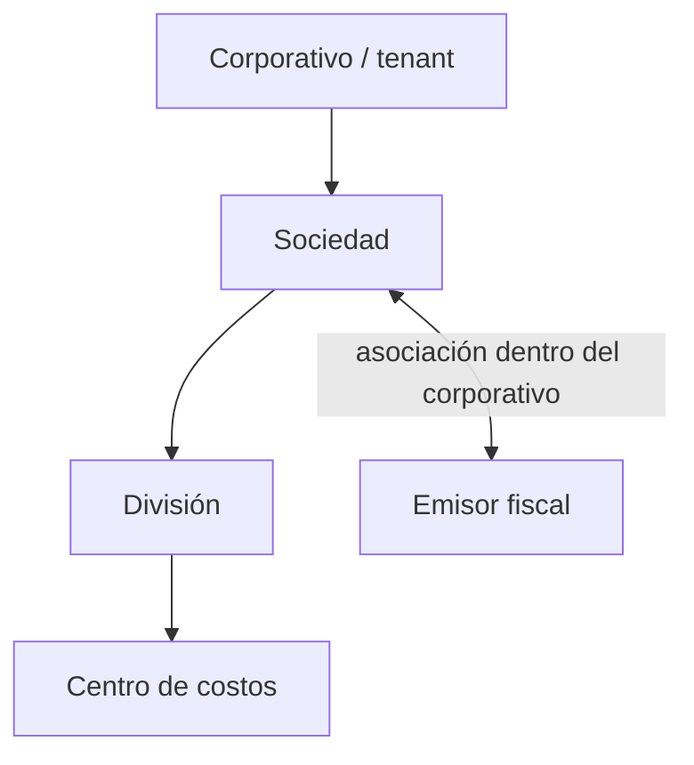
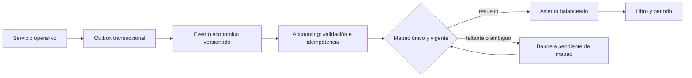

# Análisis de impacto para preparar Contabilidad

> Evidencia histórica: conserva observaciones y decisiones de su fecha; no usar como estado o instrucciones actuales. Consultar [fuente vigente](../contexto/ESTADO_ACTUAL.md).

**Cambio:** CHG-286

**Fecha:** 2026-09-21

**Estado:** propuesta de arquitectura y plan de migración; sin implementación de runtime

**Base revisada:** rama `agent/chg-278-qa-release-record`, commit `213f75c`, con cambios locales previos CHG-280 a CHG-285 preservados

**Plan derivado:** [plan de trabajo para estructura organizacional, costos y contabilidad](../arquitectura/plan_preparacion_contabilidad.md)

## 1. Objetivo solicitado

Preparar ERClave para que toda operación con efecto económico pueda llegar a Contabilidad con identidad, contexto organizacional, centro de costos, documento origen y una regla contable auditable.

La estructura objetivo planteada es:

El cambio incluye además:

- reemplazar el concepto operativo de sucursal por división;
- permitir configuración por división y reutilización controlada entre sociedades o divisiones;
- asignar códigos estables a maestros y documentos relevantes;
- identificar ventas, compras, devoluciones, mermas, entradas, salidas, trabajo y pagos;
- mapear eventos a cuentas contables sin perder el documento origen;
- cubrir movimientos normales, correcciones y reversas;
- mantener la captura ligera: cada campo debe resolver una regla o una necesidad de trazabilidad.

## 2. Conclusión ejecutiva

La dirección es correcta, pero requiere una base organizacional y transaccional antes de construir pantallas de asientos. Hoy ERClave tiene alcance por tenant y una selección de sucursal en la sesión, pero los contratos operativos no persisten `society_id`, `division_id`, `cost_center_id` ni `issuer_id`. Por ello, la sucursal seleccionada no constituye todavía una dimensión contable confiable.

El orden seguro es:

1. definir qué representa Sociedad frente a Emisor;
2. normalizar la estructura organizacional y el alcance de acceso;
3. propagar Sociedad, División y Centro de costos a los documentos operativos;
4. cerrar los huecos de códigos estables;
5. emitir eventos económicos inmutables y reversables;
6. implementar catálogo de cuentas, periodos y motor de mapeos;
7. completar factura, cuentas por cobrar/pagar, pagos y conciliación.

Empezar directamente por pólizas produciría asientos sin una dimensión organizacional verificable y obligaría a reconstruir después el origen de los movimientos.

## 3. Estado comprobado del sistema

### 3.1 Estructura organizacional actual

Administración conserva `tenant` como frontera principal de aislamiento y seguridad. El perfil organizacional vive dentro del JSONB `admin.tenant_settings`, clave `organization.profile`, con tres bloques:

- `corporate`;
- `legal_entities`;
- `branches`.

Las razones sociales y sucursales no tienen tablas propias. Los endpoints de organización editan arreglos dentro de ese JSON y generan IDs técnicos `rso_*` y `suc_*`. La razón social no tiene código de negocio; el código de sucursal es opcional.

La sesión expone alcance por `branch_ids` y datos básicos de la sucursal. El onboarding puede guardar ese alcance en `membership.metadata.scope.branch_ids`, pero la administración cotidiana de usuarios no cuenta con un recorrido completo para cambiar el alcance organizacional.

Fuentes principales:

- `backend/services/admin-service/app/schemas.py`;
- `backend/services/admin-service/app/repositories.py`;
- `backend/services/admin-service/README.md`;
- `frontend/api/admin.js` y `frontend/app.js`.

### 3.2 La operación no está dimensionada por sucursal

La revisión de schemas de Production, Inventory, Sales, Purchasing, HR y Maintenance no encontró campos persistidos `society_id`, `division_id`, `cost_center_id`, `issuer_id` ni `branch_id` en sus documentos operativos.

Dos sustitutos actuales no alcanzan para Contabilidad:

- Almacén usa `business_center` como texto libre.
- Producto/Servicio usa `cost_center` como texto libre.

Esto impide validar que un centro de costos pertenezca a la división y sociedad del documento. También permite renombrar o reutilizar textos sin conservar una identidad histórica.

### 3.3 Servicios futuros ya previstos

El repositorio ya reserva dos dueños de datos:

- `costing-service`: centros de costos, costo estimado/real, variaciones, prorrateos y rentabilidad;
- `accounting-service`: catálogo de cuentas, periodos, asientos, mapeos, pólizas y anexos.

Ambos están en estado `planned`. Sus README ya establecen que deben consumir contratos o eventos y no modificar los documentos origen. Esa separación debe conservarse.

## 4. Decisión funcional que debe cerrarse primero

### 4.1 Sociedad y Emisor no pueden quedar como sinónimos

Hay dos interpretaciones posibles:

| Interpretación | Consecuencia |
|---|---|
| Sociedad es una persona moral con RFC propio | En la práctica, Emisor y Sociedad suelen coincidir. Una relación muchos a muchos puede mezclar libros fiscales de entidades distintas. |
| Sociedad es una agrupación empresarial u operativa | Un Emisor fiscal independiente puede asociarse a varias sociedades y la relación muchos a muchos es coherente. |

La propuesta que satisface lo solicitado es usar **Sociedad como unidad empresarial de gestión** y **Emisor como identidad fiscal**. Cada evento fiscal o contable debe guardar ambas referencias cuando apliquen.

Esta definición tiene una consecuencia contable: si varias sociedades usan el mismo Emisor, comparten la misma identidad fiscal y el libro estatutario debe poder consolidarse por Emisor. Sociedad y División funcionan entonces como dimensiones de gestión dentro de ese libro.

Si el negocio espera libros fiscales independientes por Sociedad, la asociación debe restringirse o modelarse como un libro por combinación Sociedad–Emisor. Esta decisión bloquea el diseño definitivo de periodos, folios y estados financieros.

### 4.2 Alcance de la transversalidad

La asociación de un Emisor debe limitarse al mismo Corporativo/tenant. Compartirlo entre tenants rompería la frontera actual de seguridad y requeriría un modelo distinto de identidad y autorización.

## 5. Modelo objetivo mínimo

### 5.1 Entidades y dueños

| Entidad | Dueño propuesto | Campos mínimos con razón funcional |
|---|---|---|
| Corporativo | Admin, representado por `tenant` | ID técnico, código/slug, nombre y estado: aislamiento y contexto superior. |
| Sociedad | Admin | ID técnico, código estable, nombre y estado: agrupa divisiones y permite reportes de gestión. |
| División | Admin | ID técnico, `society_id`, código estable, nombre y estado: define dónde ocurre la operación. |
| Emisor fiscal | Admin o futuro Billing/Fiscal | ID técnico, código interno, RFC/tax ID, razón social, régimen, domicilio fiscal, país y estado: emitir/recibir documentos fiscales. |
| Sociedad–Emisor | Admin | IDs, uso permitido, indicador predeterminado y vigencia: resolver qué emisor puede usar cada sociedad sin duplicarlo. |
| Centro de costos | Costing | ID técnico, código estable, `division_ref_id`, nombre, estado y vigencia: acumular costos con pertenencia verificable. |
| Cuenta contable | Accounting | ID, código, nombre, tipo, naturaleza, jerarquía, moneda opcional y `requires_cost_center`: controlar contabilización. |
| Libro/ledger | Accounting | Emisor, moneda funcional, calendario y reglas de periodo: separar libros fiscales y funcionales. |
| Regla de mapeo | Accounting | evento, alcance, cuenta/rol contable, vigencia, prioridad y versión: resolver la póliza de forma reproducible. |

Costing y Accounting deben guardar referencias estables a Admin sin llaves foráneas entre schemas. Cada servicio valida las referencias mediante contrato y conserva snapshots necesarios para historia.

### 5.2 Cardinalidades propuestas

- un Corporativo contiene muchas Sociedades;
- una Sociedad contiene muchas Divisiones;
- una División pertenece exactamente a una Sociedad;
- una División contiene muchos Centros de costos;
- un Centro de costos pertenece exactamente a una División;
- una Sociedad puede usar uno o varios Emisores;
- un Emisor puede estar asociado a varias Sociedades del mismo Corporativo;
- cada contexto que permita facturar debe resolver un Emisor predeterminado sin impedir una elección autorizada.

No se propone jerarquía de centros de costos en el primer corte. Puede agregarse un `parent_id` sólo si existe una necesidad comprobada de centros agrupadores.

## 6. Alcance operativo por División

### 6.1 Regla base

Todo documento operativo nuevo debe persistir `division_ref_id`. La Sociedad se deriva y se valida desde la División, pero conviene guardar un snapshot `society_ref_id` en eventos y documentos contables para preservar historia y acelerar validaciones.

El cambio de selector en frontend no es suficiente. El backend debe validar que:

- la División pertenece al mismo tenant;
- el actor tiene acceso a esa División;
- las referencias relacionadas son compatibles con la misma Sociedad/División;
- el Centro de costos pertenece a la División;
- el Emisor está asociado a la Sociedad cuando la operación es fiscal.

### 6.2 Alcance de usuarios

La identidad del usuario debe seguir siendo corporativa. La membresía y los permisos deben aceptar alcance por Sociedad y División. Los roles pueden ser reutilizables; su asignación conserva el scope autorizado.

La sesión objetivo necesita exponer:

- sociedades visibles;
- divisiones visibles y su sociedad;
- división activa;
- emisores permitidos para el contexto;
- permisos efectivos y alcance;
- centros de costos accesibles cuando el recorrido lo requiera.

## 7. Configuración por División sin duplicación innecesaria

La configuración debe distinguir identidad maestra de activación local.

| Tipo de dato | Tratamiento recomendado |
|---|---|
| Artículo, producto, cliente, proveedor, unidad y cuenta contable | Maestro corporativo o de sociedad con ID estable. |
| Disponibilidad del artículo, almacén sugerido, mínimo/máximo, precio o política local | Asignación/configuración por División. |
| Almacén físico, ubicación, máquina y capacidad | Recurso perteneciente a una División. |
| Usuario | Identidad corporativa con acceso por scope; no se duplica. |
| Rol/perfil | Plantilla reutilizable con asignaciones acotadas por Sociedad o División. |
| Mapeo contable | Regla versionada con alcance y herencia explícitos. |

### 7.1 Herencia

Puede existir precedencia Corporativo → Sociedad → División. La aplicación debe mostrar de dónde proviene cada valor y si fue sobrescrito. En reglas contables, una ambigüedad debe quedar como error pendiente de mapeo; nunca debe elegirse silenciosamente la primera coincidencia.

### 7.2 Copia de configuración

La copia debe ser un trabajo auditable con:

- scope origen y destinos;
- tipos de configuración incluidos;
- vista previa;
- modo de conflicto `omitir`, `actualizar` o `crear`;
- versión o snapshot de origen;
- resultado por elemento;
- actor, fecha, correlación e idempotencia.

Admin puede orquestar el trabajo, pero cada servicio debe copiar o asignar sus propios datos por API/evento. No debe escribir tablas de Inventory, HR, Sales o Accounting.

Para artículos y productos, el comportamiento inicial recomendado es conservar el mismo maestro y crear una asignación a la División destino. Los almacenes, capacidades y parámetros físicos se crean como configuración local y requieren revisar los datos que no pueden heredarse.

## 8. Centro de costos y mano de obra

### 8.1 Centro de costos

El texto libre actual de Producto/Servicio debe migrar a `cost_center_ref_id` y snapshot de código/nombre cuando se genere una transacción. El centro predeterminado puede venir del producto, puesto, máquina, almacén o tipo de gasto, pero el documento debe guardar la resolución efectiva.

### 8.2 Puesto y tarifa

`hr.labor_roles` tiene ID técnico, puesto, nombre de receta, disponibilidad y costo por hora, pero no tiene código de negocio. Aunque Admin ya siembra la secuencia `hr.position`, el frontend y el contrato no la usan.

Se requiere:

- `code` estable y único por tenant para cada puesto;
- asignación o regla predeterminada de Centro de costos;
- tarifa con vigencia o, como mínimo, snapshot de puesto, código, costo y fecha en cada consumo;
- separación entre costo de gestión y pasivo de nómina.

Las horas de mano de obra alimentan costeo. No crean por sí solas una deuda laboral completa: nómina, prestaciones, impuestos y retenciones aún no existen como dominio.

### 8.3 Huecos actuales de consumo de tiempo

- Producción conserva código y costo unitario de recursos en el snapshot de la orden, pero no guarda División o Centro de costos.
- Sales conserva costo por hora y total en tiempos de órdenes de servicio, pero necesita snapshot del código de puesto, fuente de tarifa y Centro de costos.
- Maintenance guarda trabajador, inicio, fin y minutos, pero no puesto, tarifa, costo ni Centro de costos. Sus materiales sí conservan mejor el costo del artículo.

## 9. Identidad de eventos y significado contable

### 9.1 Identidad obligatoria

Cada operación con efecto económico debe producir un evento con:

- `event_id` inmutable;
- `event_type` y `schema_version`;
- `tenant_id`, `society_ref_id`, `division_ref_id` y `cost_center_ref_id`;
- `issuer_ref_id` cuando exista efecto fiscal;
- servicio, tipo, ID, código y línea del documento origen;
- fecha de ocurrencia y fecha de registro;
- moneda, tipo de cambio, importes e impuestos aplicables;
- tercero relacionado cuando aplique;
- versión y clave de idempotencia;
- `reversal_of_event_id` para correcciones;
- snapshots legibles de dimensiones y códigos.

La unicidad recomendada para consumo es `(tenant_id, source_service, source_event_id, event_version)`. El folio visible del documento no debe usarse como llave de idempotencia.

### 9.2 Débito/crédito frente a positivo/negativo

Contabilidad no debe interpretar un número genérico positivo o negativo. El evento expresa qué ocurrió y su dirección económica; la naturaleza de cada cuenta y la plantilla de mapeo determinan cargos y abonos.

Ejemplos:

- un cargo aumenta normalmente un activo, pero reduce normalmente un pasivo;
- una devolución no debe editar la venta original: genera un evento compensatorio relacionado;
- una reversa conserva el evento original y crea el movimiento opuesto;
- un CFDI no debe usar importes negativos como sustituto de una nota de crédito o relación fiscal.

### 9.3 Flujo propuesto

El servicio operativo confirma su propia transacción y escribe un outbox en la misma transacción local. Accounting consume después. Un fallo contable no debe borrar la operación: debe quedar visible, reintentable y con correlación.

## 10. Matriz de eventos que deben contemplarse

| Dominio | Evento | Efecto esperado o decisión necesaria | Estado actual |
|---|---|---|---|
| Ventas | Cotización aprobada | Sin asiento; compromiso comercial. | Implementado, sin evento contable. |
| Ventas | Pedido confirmado | Normalmente sin asiento; posible cuenta de orden por política. | Implementado. |
| Ventas/Inventory | Entrega confirmada | Consumo de inventario y costo de venta según política. | Entrega y movimiento existen; sin dimensión contable. |
| Facturación | CFDI/factura de ingreso | Clientes por cobrar, ingreso e impuestos. | No implementado. |
| Ventas | Devolución, nota de crédito y reembolso | Evento compensatorio, relación al origen, reintegro de inventario si aplica. | No implementado. |
| Cobranza | Cobro y aplicación | Banco/clearing contra cliente; complemento de pago cuando aplique. | No implementado. |
| Compras | Requisición/orden de compra | Sin asiento; compromiso. | Implementado. |
| Compras/Inventory | Recepción | Inventario o gasto contra recepción no facturada, según política. | Implementado; factura proveedor ausente. |
| Cuentas por pagar | Factura proveedor | Proveedor, impuestos, inventario/gasto y conciliación con recepción. | No implementado. |
| Compras | Devolución a proveedor/nota | Compensa recepción o factura y salida física. | No implementado. |
| Pagos | Pago a proveedor | Proveedor contra banco/clearing; comisiones aparte. | No implementado. |
| Inventory | Entrada | Aumenta inventario con contrapartida según origen. | Implementado. |
| Inventory | Salida | Reduce inventario; contrapartida según consumo/venta/gasto. | Implementado. |
| Inventory | Ajuste positivo/negativo | Diferencia de inventario con motivo tipificado. | Implementado con motivo libre; falta tipificación contable. |
| Inventory | Transferencia | Reclasificación por almacén/División; entre Sociedades requiere flujo intercompañía. | Implementado sin pertenencia de División. |
| Inventory | Reversa | Movimiento opuesto ligado al original. | Implementado a nivel inventario. |
| Producción | Salida de materiales | Materia prima a producción en proceso o gasto. | Implementado. |
| Producción | Mano de obra/máquina real | Producción en proceso contra absorción/costo. | Costos y snapshots parciales implementados. |
| Producción | Recepción de terminado | Producto terminado contra producción en proceso. | Implementado. |
| Producción | Merma/scrap/variación | Pérdida, recuperación o variación tipificada. | No existe evento de dominio suficiente. |
| Mantenimiento | Refacciones | Gasto/mantenimiento, producción en proceso o activo, según política. | Salida y costo de material existen. |
| Mantenimiento | Tiempo | Gasto o costo capitalizable con tarifa y Centro de costos. | Minutos existen; costo y snapshot faltan. |
| Gastos | Gasto directo/anticipo/reembolso | Gasto, impuestos, proveedor/empleado y pago. | Módulo no implementado. |
| Activos fijos | Alta/depreciación/baja | Activo, depreciación y resultado de baja. | Registro de activos no implementado. |

Esta matriz muestra que Contabilidad puede iniciar con inventario, producción y costo, pero una contabilidad financiera completa también requiere factura, cuentas por cobrar, cuentas por pagar, pagos, impuestos y activos fijos.

## 11. Mapeos contables

### 11.1 Regla de resolución

Una regla puede considerar:

- Emisor/libro;
- Sociedad y División;
- tipo y versión de evento;
- artículo, producto/servicio o categoría;
- almacén;
- cliente/proveedor o grupo;
- Centro de costos;
- instrumento de pago;
- moneda e impuesto;
- vigencia.

La regla más específica y vigente gana sólo si es única. Si faltan cuentas o hay empate, el evento pasa a una bandeja pendiente. El sistema debe conservar la versión de la regla y las cuentas resueltas en el asiento para que un cambio futuro no reescriba la historia.

### 11.2 Centro de costos obligatorio

Conviene hacer obligatorio el Centro de costos en los eventos operativos que representan consumo, ingreso, gasto, producción o merma. En cada línea contable, la cuenta define `requires_cost_center`.

Aplicarlo sin excepción a toda cuenta de activo y pasivo puede forzar datos artificiales en bancos, impuestos o cuentas por cobrar. Si el negocio requiere centro en absolutamente todas las líneas, debe existir una política explícita por libro y centros administrativos válidos, no un valor ficticio.

## 12. Formas, métodos e instrumentos de pago

Hoy Administración sólo tiene `payment_terms`, que representa condiciones o plazo de pago. Deben separarse cuatro conceptos:

| Concepto | Ejemplo | Uso |
|---|---|---|
| Condición de pago | Contado, crédito 30 días | Vencimiento comercial. |
| Método de pago SAT | PUE, PPD | Tratamiento fiscal del momento del pago. |
| Forma de pago SAT | 01, 03, 04, 28, 99 | Clave fiscal del medio general. |
| Instrumento interno | Visa Débito BBVA terminación 1234 | Cuenta bancaria, caja, tarjeta o procesador concreto usado en la operación. |

El ejemplo planteado debe registrarse como un instrumento interno asociado a la forma SAT `28` para tarjeta de débito. La clave `04` corresponde a tarjeta de crédito. El SAT trata `FormaPago` y `MetodoPago` como catálogos distintos y CFDI 4.0 sigue siendo la versión vigente publicada en su portal.

Fuentes oficiales consultadas el 2026-09-21:

- [SAT: Formato de Factura, Anexo 20](https://wwwmat.sat.gob.mx/consultas/35025/formato-de-factura-electronica-%28anexo-20%29);
- [SAT: RMF 2026, medios de pago 03, 04 y 28](https://www.sat.gob.mx/minisitio/NormatividadRMFyRGCE/documentos2026/rmf/rmf/RMF_2026-DOF-28122025.pdf).

### 12.1 Catálogo mínimo de instrumento interno

- ID técnico y código interno estable;
- nombre visible;
- tipo: caja, banco, crédito, débito, transferencia, procesador u otro;
- clave SAT `c_FormaPago` con vigencia;
- moneda;
- Emisor/Sociedad autorizados;
- cuenta contable de banco o clearing;
- cuenta de comisiones, cuando aplique;
- estado y vigencia;
- referencia enmascarada, nunca credenciales o números completos sensibles.

## 13. Auditoría de IDs y códigos automáticos

### 13.1 Resultado general

Los repositorios generan IDs técnicos para las filas persistidas. El hueco está en los códigos de negocio visibles y estables.

Admin siembra actualmente 15 secuencias de documentos. La revisión de consumidores encontró lo siguiente:

| Entidad/documento | ID técnico | Código actual | Secuencia central | Resultado |
|---|---|---|---|---|
| Producto/Servicio, Receta, Orden de producción, Máquina | Sí | Sí | Sí y consumida | Cubierto. |
| Almacén, Artículo | Sí | Sí | Sí y consumida | Cubierto. |
| Movimiento de inventario | Sí | `MOV-` aleatorio | Existe | **Desalineado:** la secuencia no se consume. |
| Área RH, Empleado | Sí | Sí | Sí y consumida | Cubierto. |
| Puesto RH | Sí | No existe | Existe | **Hueco crítico:** secuencia sembrada sin campo ni consumidor. |
| Cliente, Cotización, Pedido, Entrega | Sí | Sí | Sí y consumida | Cubierto. |
| Orden de servicio Sales | Sí | Sí | Sí, asignada por backend | Cubierto. |
| Proveedor | Sí | Manual obligatorio | No | Falta automatización. |
| Requisición, Orden de compra, Recepción | Sí | Manual obligatorio | No | Falta automatización. |
| Orden de mantenimiento | Sí | Manual obligatorio | No | Falta automatización. |
| Razón social actual | Sí | No | No | Debe resolverse al migrar Sociedad/Emisor. |
| Sucursal actual | Sí | Opcional/manual | No | División necesita código estable. |
| Centro de costos | No implementado | No | No | Debe incluirse al crear Costing. |

Las líneas internas, auditorías y snapshots pueden conservar sólo ID técnico. No es necesario mostrar un folio adicional al usuario cuando la línea ya pertenece a un documento identificable.

## 14. Cambios por módulo

### Administración

- migrar `organization.profile` a entidades normalizadas;
- crear Sociedad, División, Emisor y asociación;
- migrar alcance de `branch_ids` a scopes nuevos;
- exponer contexto activo y validación autoritativa;
- agregar secuencias y orquestación de copia.

### Inventarios

- reemplazar `business_center` libre por `division_ref_id`;
- asignar División a almacenes y validar movimientos;
- usar la secuencia central de movimientos;
- tipificar merma, ajuste, devolución y transferencia;
- impedir una transferencia entre Sociedades por el flujo simple.

### Producción

- reemplazar `cost_center` libre por referencia;
- persistir División y Centro de costos en orden, consumos y recepción;
- crear eventos explícitos de merma y variación;
- conservar tarifas y dimensiones resueltas en snapshots.

### Recursos Humanos

- agregar código de Puesto y consumir `hr.position`;
- agregar vigencia/snapshot de tarifa;
- asociar puesto o consumo de tiempo a Centro de costos;
- mantener separado el costeo de horas de la futura nómina.

### Ventas

- dimensionar cotización, pedido, entrega y orden de servicio;
- definir el momento contable de ingreso y costo de venta;
- implementar factura/CFDI, devolución, nota de crédito, cobro y reembolso;
- mapear producto/servicio, impuestos e instrumento de pago.

### Compras

- automatizar códigos de proveedor, requisición, orden y recepción;
- dimensionar documentos y recepciones;
- implementar factura proveedor, devolución, nota y pago;
- conciliar orden, recepción y factura.

### Mantenimiento

- automatizar folio de orden;
- dimensionar orden, tiempo y materiales;
- guardar puesto, tarifa, costo y Centro de costos en el tiempo;
- definir si el costo es gasto, producción en proceso o capitalizable.

### Costing y Accounting

- implementar maestros y contratos planeados;
- consumir eventos sin modificar documentos de otros servicios;
- ofrecer bandejas de errores, pendientes de mapeo y conciliación;
- conservar balance, periodos, reversas y auditoría.

## 15. Migración propuesta por fases

### Fase 0 — decisiones de negocio

Cerrar antes de migrar:

1. significado jurídico/operativo de Sociedad;
2. dueño del libro: Emisor o combinación Sociedad–Emisor;
3. obligatoriedad de Centro de costos por tipo de cuenta/evento;
4. momento de reconocimiento para venta, compra, entrega y recepción;
5. moneda funcional y política de tipo de cambio;
6. tratamiento de transferencias entre Sociedades;
7. herencia frente a copia de configuración.

### Fase 1 — cimiento organizacional

- crear tablas Admin de Sociedad, División, Emisor y asociaciones;
- migrar razones sociales y sucursales actuales con tabla de equivalencias;
- conservar compatibilidad temporal para lectores del JSON;
- actualizar sesión, selector y scopes;
- asignar códigos estables.

### Fase 2 — dimensiones operativas

- agregar División/Sociedad a almacenes, máquinas y documentos;
- crear un scope predeterminado controlado para datos existentes;
- backfill antes de exigir `NOT NULL`;
- agregar Centros de costos y sustituir textos libres;
- validar aislamiento y pertenencia en backend.

### Fase 3 — identidad de negocio

- implementar código de Puesto;
- alinear Movimiento de inventario con su secuencia;
- agregar secuencias de Compras, Mantenimiento y nueva estructura;
- documentar qué filas internas requieren sólo ID técnico.

### Fase 4 — eventos y costeo

- definir envelope versionado;
- agregar outbox por servicio;
- emitir entradas, salidas, consumo, producción, entrega, tiempo y reversa;
- implementar snapshots de costo, dimensiones y códigos;
- mostrar eventos fallidos o pendientes.

### Fase 5 — núcleo contable

- catálogo de cuentas y libros;
- periodos y bloqueo de contabilización;
- reglas de mapeo con vigencia y prioridad;
- asientos balanceados, pólizas, anexos y reversas;
- bandeja de mapeo pendiente y reproceso idempotente.

### Fase 6 — fiscal, cuentas y tesorería

- CFDI/factura e impuestos;
- cuentas por cobrar y pagar;
- notas, devoluciones, cobros, pagos y complementos;
- instrumentos internos, bancos, clearing, comisiones y conciliación.

### Fase 7 — copia y plantillas

- vista previa y copia por recurso;
- perfiles reutilizables con overrides;
- resultados y auditoría por destino;
- protección contra duplicados y repetición idempotente.

## 16. Primer corte recomendado

El primer corte implementable debe limitarse al cimiento organizacional:

1. aprobar la semántica Sociedad–Emisor;
2. crear las entidades normalizadas en Admin y migrar los datos actuales;
3. convertir Sucursal en División en contratos, sesión, permisos y UI;
4. conservar compatibilidad de lectura durante la migración;
5. no propagar a todos los documentos hasta que exista una División predeterminada validada para cada tenant.

### Criterios de aceptación de ese corte

- ningún registro organizacional existente se pierde;
- toda Sociedad, División y Emisor tiene ID y código estable;
- una División pertenece a una sola Sociedad;
- una asociación Sociedad–Emisor no cruza tenants;
- una sesión sólo ve divisiones autorizadas;
- el backend rechaza IDs de otro tenant;
- onboarding y administración de usuarios pueden gestionar el nuevo scope;
- existe rollback o estrategia de compatibilidad para el JSON anterior;
- contratos OpenAPI, migración, pruebas y documentación cambian juntos.

## 17. Riesgos principales y controles

| Riesgo | Control necesario |
|---|---|
| Confundir Sociedad con persona moral | Decisión explícita y modelo de libro antes de implementar. |
| Renombrar UI sin dimensionar documentos | Campo obligatorio y validación backend en cada escritura. |
| Duplicar maestros al copiar configuración | Separar maestro de asignación local. |
| Romper historia al cambiar mapeos o tarifas | Versiones, vigencia y snapshots. |
| Doble contabilización por reintentos | Outbox e idempotencia por evento/version. |
| Borrar o editar efectos ya contabilizados | Reversas y eventos compensatorios. |
| Asiento incompleto por mapeo faltante | Bandeja pendiente; no selección silenciosa. |
| Cruce entre tenants o sociedades | Validación de pertenencia en backend y pruebas negativas. |
| Centro de costos ficticio para cuadrar captura | Regla por cuenta/evento y centros administrativos reales. |
| Catálogo fiscal obsoleto | Fuente oficial, vigencia y versión del catálogo. |

## 18. Decisiones pendientes para autorizar implementación

1. Confirmar que Sociedad es una unidad empresarial de gestión y Emisor es la identidad fiscal reusable dentro del Corporativo.
2. Elegir si el libro contable pertenece al Emisor o a la combinación Sociedad–Emisor.
3. Definir si Centro de costos es obligatorio en todos los eventos operativos y sólo en cuentas marcadas, o en cada línea contable sin excepción.
4. Definir qué configuraciones se heredan en vivo y cuáles se copian como snapshot editable.
5. Definir el Centro de costos y la División predeterminados para migrar datos existentes.
6. Definir el momento contable de costo de venta, ingreso, recepción y compra.

## 19. Impacto de este análisis

- **Runtime:** ninguno.
- **Datos/migraciones:** ninguno.
- **QA/Producción:** no consultados ni modificados.
- **APIs afectadas:** ninguna API modificada o invocada. Se revisaron estáticamente contratos y código de Admin, Production, Inventory, Sales, Purchasing, HR y Maintenance.
- **Siguiente cambio recomendado:** Fase 0 y diseño contractual de Fase 1; no implementar asientos todavía.
